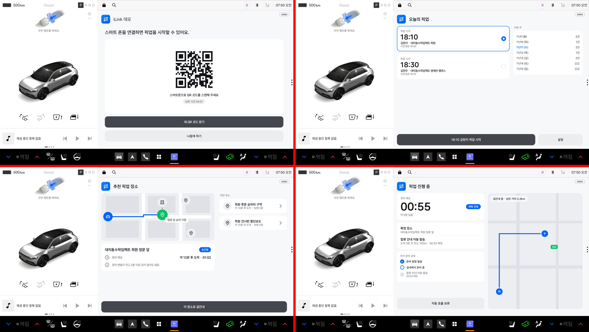
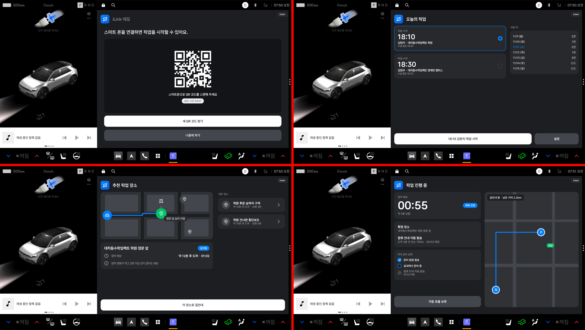

# iLink - 차량 앱

학원 하원 픽업을 도와주는 Pleos Connect 차량용 앱입니다.
보호자 휴대전화 앱(ilink-mobile)과 같은 서버를 쓰고, 차에서는 연결 → 오늘의 픽업 → 픽업 장소 추천 → 픽업 진행 순서로 흘러갑니다.





> Pleos Connect 에뮬레이터(v2.1.0)에서 V00부터 V03까지 직접 눌러 가며 캡처한 화면입니다. 위가 라이트, 아래가 다크 모드입니다.

## 현재 구현 범위

디자인 시안이 나온 화면부터 먼저 만들었습니다.

| 화면 | 주행 중 | 정차 중 |
|---|---|---|
| V00 서비스 시작·연결 | 로그인 불가 안내 | QR 연결 코드, 남은 시간, 새 QR 받기 / 나중에 하기 |
| V01 오늘의 픽업 | 다음 픽업 1건 + 시작 | 디자인 개선안 그대로: 인사말, 좌우로 넘기는 날짜 띠(양 끝 흐림), 아이별 픽업 카드 |
| V02 픽업 장소 | 추천 1곳 + 길안내 | 지도, 정차 예상·추천 이유, 대안 장소 선택 |
| V03 픽업 진행 | 정차 예상 크게, 아이 상태, 호출 보류 | 지도와 아이 준비 단계까지 |
| V04 합류 진행 상태 | 발송·열람·정차 단계, 호출 보류 | 직접 연락, 도어 신호가 없으면 수동 완료 |
| V05 탑승 자동 확인 | 완료 카드 | 합류 상태, 지금 완료(10초 뒤 자동), 아이가 타지 않았어요 |
| V06 안전 확인 필요 | 직접 연락 | 승인된 대안 → 다시 길안내, 직접 연락, 보류·취소 |
| U01~U08 음성 안내 | 상태가 바뀌면 '발화 중'과 안내 카드를 창에 띄움 (U08은 '상태', '보류' 명령) | |

- 주행/정차는 차량 주행 규제(CarUxRestrictions)로 판단합니다. 데모에서는 기어가 D면 주행 중입니다.
- 화면은 다크 컨셉 하나만 씁니다. Pleos 디자인 가이드는 라이트/다크 둘 다를 요구하지 않고, 글자·아이콘 대비 4.5:1 이상을 요구합니다.
- 지도는 아직 지도 SDK 없이 그림으로 그린 지도입니다. (`ui/component/SchematicMaps.kt`)
- V02의 정차 예상 시간과 추천 이유는 서버 API가 아직 없어서 받을 자리만 만들어 두었습니다. 자세한 건 [docs/api-gap.md](docs/api-gap.md)에 정리했습니다.

## 가벼운 Pleos Connect 에뮬레이터 실행

Pleos Connect 에뮬레이터는 기본 설정(RAM 8GB)으로 띄우면 너무 무거워서, 노트북에서도 돌릴 수 있게 가볍게 띄우는 스크립트를 만들었습니다.

| 스크립트 | 하는 일 |
|---|---|
| `scripts/run-pleos.sh` | Pleos Connect 이미지로 AVD를 만들고 RAM 4GB로 띄운 뒤 앱 설치·실행 |
| `scripts/run-pleos.sh --headless` | 창 없이 띄우기 (캡처만 할 때) |
| `scripts/pleos-flow-capture.sh` | 띄워 둔 에뮬레이터에서 V00 → V03을 자동으로 눌러 가며 라이트·다크 캡처 |
| `scripts/run-demo.sh` | Pleos 이미지 대신 일반 Android Automotive 이미지(RAM 2GB)로 더 가볍게 데모 실행 |
| `scripts/capture-screens.sh` | 에뮬레이터 없이 Robolectric으로 화면별 PNG 캡처 |

```bash
scripts/run-pleos.sh --headless
scripts/pleos-flow-capture.sh
```

### Pleos 이미지 준비

1. Android Studio > SDK Manager > SDK Update Sites에 Pleos 이미지 주소를 추가합니다.
   - Windows/Linux: `https://nexus-playground.pleos.ai/repository/raw-releases/connect-avd/2.x/crp-sys-img.xml`
   - macOS(Apple Silicon): `https://nexus-playground.pleos.ai/repository/raw-releases/connect-avd/2.x/crp-arm64-sys-img.xml`
2. "Pleos Connect System Image"(API 34)를 설치합니다. AVD는 `run-pleos.sh`가 알아서 만듭니다.

### 데모 모드

에뮬레이터에는 실제 서버와 차량 신호가 없어서 `demo` 빌드를 따로 두었습니다. (패키지 `com.ilink.vehicle.demo`)

- 서버 응답은 `demo/DemoServer.kt`, 내비·기어·도어·위치 신호는 `demo/DemoWorld.kt`가 대신 냅니다. 앱의 나머지 로직은 실제 빌드와 같습니다.
- 흐름: 연결 코드가 약 12초 뒤 자동 승인 → 픽업 시작 → 이 장소로 길안내 → 약 30초 동안 접근 → 도착 후 기어 P → 뒷문 개폐로 탑승 감지 → 완료
- 오른쪽 위 DEMO 버튼으로 주행 규제, 도어 신호 끊김, 바로 도착, 처음부터를 조작할 수 있습니다.

## 빌드

```bash
./gradlew installDebug
```

- API 서버 주소는 `app/build.gradle.kts`의 `API_BASE_URL`에서 바꿉니다.
- 단위 테스트: `./gradlew testDebugUnitTest` (도어 판정, 세션 병합, 데모 서버 흐름)

## 개발 환경

- Kotlin, Jetpack Compose
- Pleos Connect 에뮬레이터 v2.1.0 (Android 14, API 34)
- JDK 17 이상, Android SDK 35

## 문서

- [docs/design.md](docs/design.md) 구조와 흐름
- [docs/api-gap.md](docs/api-gap.md) 기획서와 서버 API 차이
