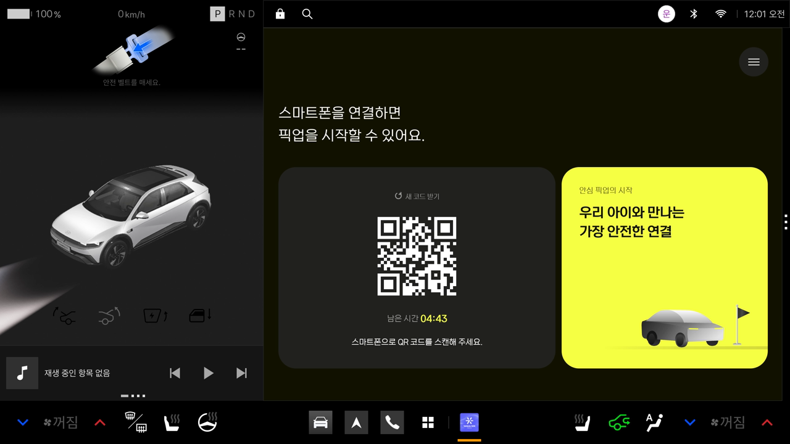
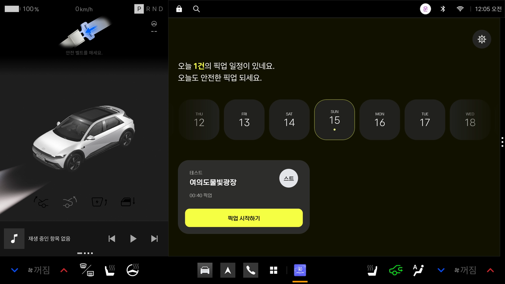
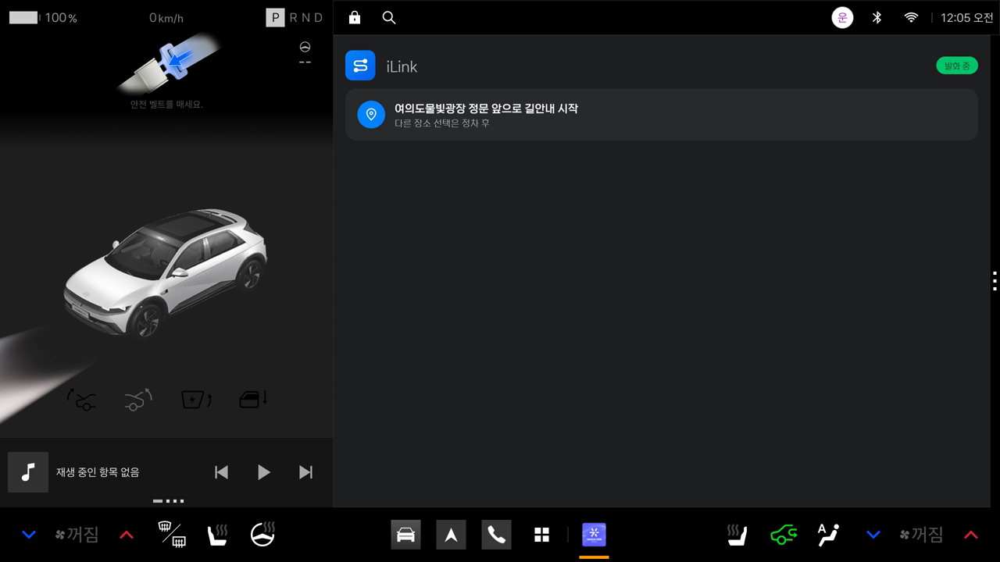
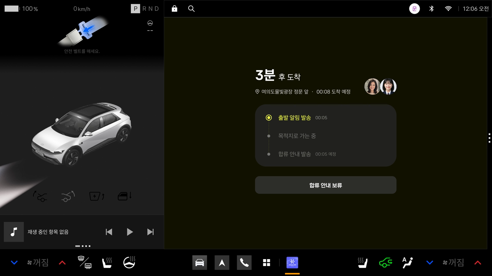
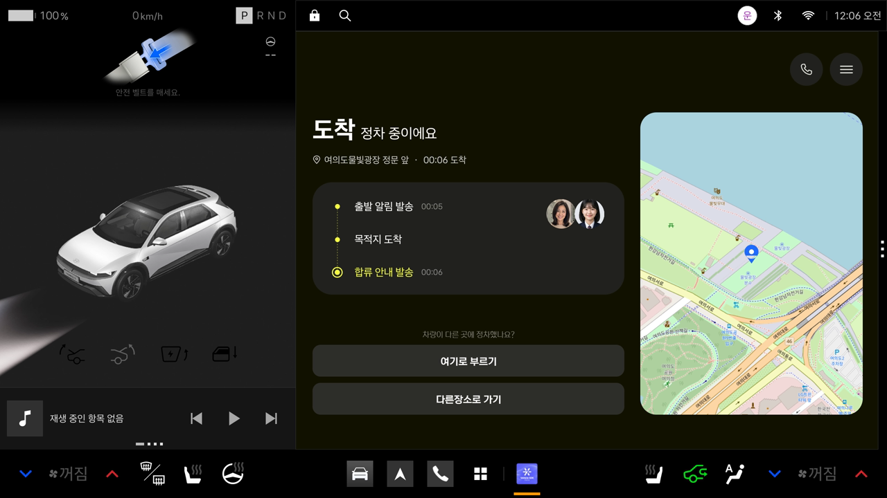
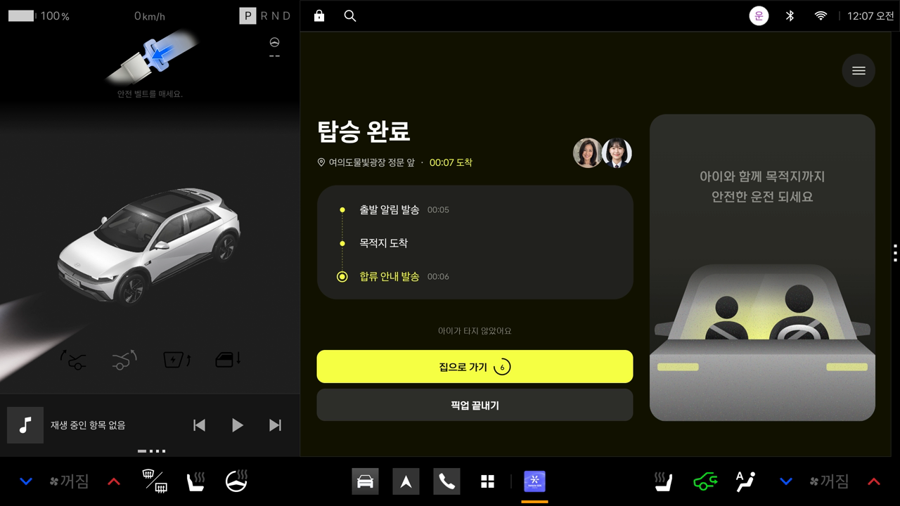

<div align="center">


# iLink Vehicle

**차가 멈춘 걸 확인한 뒤에 아이를 부르는 픽업 앱**<br/>
Pleos Connect 차량용 앱 (Android Automotive)


[모바일 앱 (iLink-Client)](https://github.com/Hyundai-Motor-Competition/iLink-Client) ·
[기획안](https://docs.google.com/spreadsheets/d/100loJGe8NF_Yxbjat_zQi9Y1dwDjXLRuzn82QDN2BA0/edit) ·
[시연 방법](https://github.com/Hyundai-Motor-Competition/iLink-Client/blob/main/docs/demo.md)

</div>

<br/>


<p align="center"><sub>왼쪽이 이 저장소의 차량 앱입니다. 자녀(Android) · 보호자(iOS) 앱과 같은 개발 서버에 붙여서 찍었습니다.</sub></p>

## 차에서 하는 일

학원 앞 픽업에서 제일 애매한 순간은 "지금 아이를 불러도 되나"입니다. 너무 일찍 부르면 아이가 길가에서 기다리고, 늦으면 차가 정문 앞에 오래 서 있게 됩니다.

차량 앱은 그 판단을 차 신호로 합니다. 기어가 P로 바뀌고 정차한 걸 확인하면 서버가 자녀에게 합류 안내를 보내고, 뒷문이 열렸다 닫히면 탑승으로 봅니다. 운전자는 화면을 거의 만지지 않아도 되고, 주행 중에는 화면이 단순해집니다.

<p align="center"></p>
<p align="center"><sub>출발부터 탑승 완료까지 (빨리 감기)</sub></p>

## 화면

Pleos Connect 에뮬레이터에서 실제 서버로 돌린 화면입니다.

<table>
  <tr>
    <td align="center"><br/><sub>V00 연결 — 보호자 폰으로 QR을 찍으면 가족과 연결</sub></td>
    <td align="center"><br/><sub>V01 오늘의 픽업 — 날짜 띠, 아이별 픽업 카드</sub></td>
  </tr>
  <tr>
    <td align="center"><br/><sub>V02 장소 선택 — 저장된 장소 · 운전 시간, 8초 뒤 자동 출발</sub></td>
    <td align="center"><br/><sub>V03 가는 중 — 남은 시간, 합류 안내 단계</sub></td>
  </tr>
  <tr>
    <td align="center"><br/><sub>V05 도착 · 정차 — 합류 안내 발송, 여기로 부르기</sub></td>
    <td align="center"><br/><sub>탑승 완료 — 문 신호로 인식, 집으로 가기</sub></td>
  </tr>
</table>

<details>
<summary>화면별 정차 중 · 주행 중 차이</summary>

| 화면 | 정차 중 | 주행 중 |
|---|---|---|
| V00 서비스 시작 · 연결 | QR 카드(새 코드 받기 · 남은 시간), 차가 달려와 깃발 앞에 서는 애니메이션 | 로그인 불가 안내 |
| V01 오늘의 픽업 | 인사말, 좌우로 넘기는 날짜 띠, 아이별 픽업 카드 | 다음 픽업 1건 + 시작 |
| V02 픽업 장소 선택 | 장소 카드(운전 시간 · 도착 시각), 추천 장소, 작은 지도, 8초 뒤 자동 출발 | 추천 1곳 + 길안내 |
| V03 · V04 목적지로 가는 길 | 남은 시간, 출발 알림 → 가는 중 → 합류 안내 단계, 합류 안내 보류 | 가운데 좁은 틀 |
| V05 도착 · 정차 | 합류 안내 진행, 여기로 부르기, 다른 장소로 가기 | 합류 진행 상태 |
| V06 다른 장소로 가기 | 대안 장소 골라 출발(8초 자동) → 다시 길안내 | |
| 탑승 완료 | 진행 단계, 집으로 가기(8초 뒤 자동), 10초 안에는 '아이가 타지 않았어요' | 제목 · 탑승 시각 + 두 버튼 |
| 안전 확인 필요 | 정차 실패 · 미탑승: 직접 연락, 대안, 보류 · 취소 | 직접 연락 |
| U01~U08 음성 안내 | 상태가 바뀌면 음성과 안내 카드 | |

</details>

## 구현하면서 신경 쓴 것

**주행 중에는 덜 보여 줍니다.** 주행 여부는 `CarUxRestrictions`로 판단하고, 주행 중에는 버튼과 글자를 줄인 별도 배치를 씁니다. 다크 컨셉 하나에 글자 · 아이콘 대비 4.5:1 이상, 글꼴은 NeoHyundai입니다.

**차 신호로 상태를 정합니다.** 기어(P), 정차, 뒷문 열림 · 닫힘(`DoorCycleDetector`)을 서버 이벤트로 보내고, 합류 안내 · 탑승 판정은 서버 규칙(가드 G6: 정차 확인 뒤에만 합류 안내)을 따릅니다. 화면 상태는 서버 세션과 차 신호를 합쳐 `SessionReducer`가 만듭니다.

**음성으로 알려 줍니다.** 출발 · 곧 도착 · 합류 안내 · 탑승 같은 순간마다 Pleos TTS로 짧게 안내합니다(`VoiceCues`).

**에뮬레이터에서도 끝까지 돌아가게.** Pleos 에뮬레이터는 차량 신호(VHAL) 주입을 막아 둬서, debug 빌드에는 adb broadcast로 위치 · 기어 · 문 신호를 넣는 `SimInput`을 두었습니다. 길안내도 이때는 흉내 내고, 도착 예정 시간은 거리로 계산합니다(`EtaFallback`). release 빌드는 Pleos SDK 값만 씁니다.

## 기술 스택

| 구분 | 사용 |
|---|---|
| 앱 | Kotlin 2.0, Jetpack Compose, Coroutines · Flow |
| 차량 연동 | Pleos Connect SDK (내비 · 위치 · 차량 신호 · TTS), CarUxRestrictions |
| 지도 · 그림 | osmdroid(OpenStreetMap, 키 없음), Lottie |
| 서버 | REST + SSE 세션 스트림 (`data/remote`) |
| 환경 | Pleos Connect 에뮬레이터 v2.1.0 (Android 14, API 34), minSdk 28 |

## 폴더 구조

```
app/src/main/java/com/ilink/vehicle/
├─ ui/         화면(연결 · 오늘의 픽업 · 장소 · 가는 길 · 도착 · 완료 · 음성), 테마, 공용 컴포넌트
├─ domain/     세션 병합(SessionReducer), 문 개폐 판정, 음성 안내 규칙
├─ data/       서버 API · SSE, 연결 · 세션 저장소
├─ platform/   Pleos 연동(내비 · 위치 · 차량 신호 · 주행 규제 · TTS), 시연 신호 입력(sim)
├─ service/    픽업 진행 중 포그라운드 서비스
└─ demo/       서버 · 차량 없이 도는 데모 빌드용 가짜 서버 · 차량
```

## 실행 방법

JDK 17 이상, Android SDK 35(Android Studio), Pleos Connect 에뮬레이터 이미지 v2.1.0이 필요합니다.

```bash
git clone https://github.com/Hyundai-Motor-Competition/iLink-Vehicle.git
```

```bash
cd iLink-Vehicle
```

데모 빌드 (서버 · 차량 신호 없이 전체 흐름)

```bash
scripts/run-pleos.sh
```

에뮬레이터를 RAM 4GB로 가볍게 띄우고 데모 앱(`com.ilink.vehicle.demo`)을 실행합니다. 약 12초 뒤 연결이 자동 승인되고, 오른쪽 위 DEMO 버튼으로 주행 규제 · 도어 신호 끊김 · 바로 도착을 조작할 수 있습니다.

실제 서버로

```bash
scripts/run-pleos.sh --real
```

```bash
adb shell am broadcast -p com.ilink.vehicle -a com.ilink.vehicle.SIM --es gear D --ez driving true
```

```bash
adb shell am broadcast -p com.ilink.vehicle -a com.ilink.vehicle.SIM --es door REAR_RIGHT --ez open true
```

<details>
<summary>Pleos 이미지 준비 · 그 밖의 스크립트</summary>

1. Android Studio > SDK Manager > SDK Update Sites에 Pleos 이미지 주소를 추가합니다.
   - Windows/Linux: `https://nexus-playground.pleos.ai/repository/raw-releases/connect-avd/2.x/crp-sys-img.xml`
   - macOS(Apple Silicon): `https://nexus-playground.pleos.ai/repository/raw-releases/connect-avd/2.x/crp-arm64-sys-img.xml`
2. "Pleos Connect System Image"(API 34)를 설치합니다. AVD는 `run-pleos.sh`가 만듭니다.

| 스크립트 | 하는 일 |
|---|---|
| `scripts/run-pleos.sh --headless` | 창 없이 띄우기 (캡처용) |
| `scripts/pleos-flow-capture.sh` | 띄워 둔 에뮬레이터에서 V00 → V03을 눌러 가며 캡처 |
| `scripts/run-demo.sh` | 일반 Android Automotive 이미지(RAM 2GB)로 더 가볍게 데모 |
| `scripts/capture-screens.sh` | 에뮬레이터 없이 Robolectric으로 화면별 PNG 캡처 |

</details>

빌드 · 테스트

```bash
./gradlew installDebug
```

```bash
./gradlew testDebugUnitTest
```

단위 테스트는 도어 판정, 세션 병합, 음성 안내, 데모 서버 흐름을 다룹니다. 서버 주소는 `app/build.gradle.kts`의 `API_BASE_URL`입니다.

## 문서

- [docs/design.md](docs/design.md) — 구조와 흐름
- [docs/api-gap.md](docs/api-gap.md) — 기획서와 서버 API가 다른 곳
- 세 화면 시연 영상 찍는 방법 — 모바일 저장소 [docs/demo.md](https://github.com/Hyundai-Motor-Competition/iLink-Client/blob/main/docs/demo.md)
