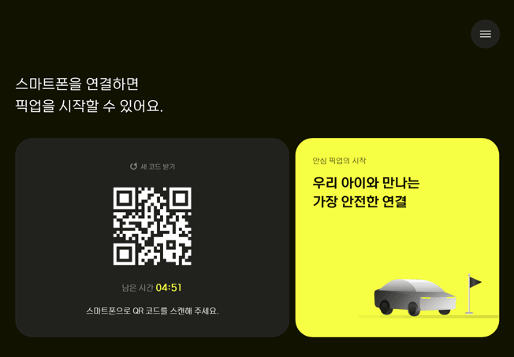
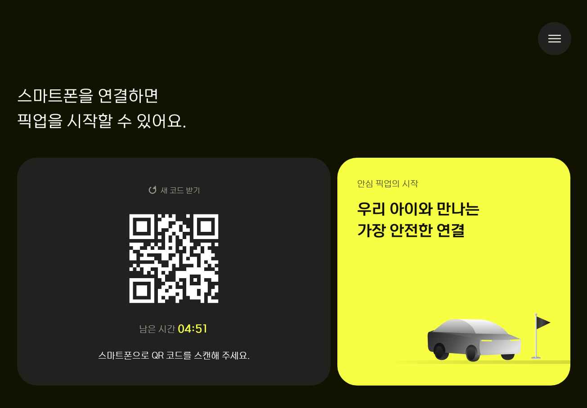
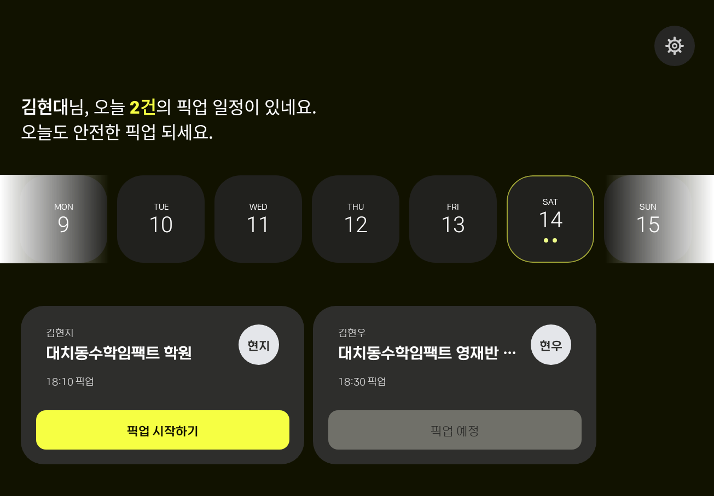
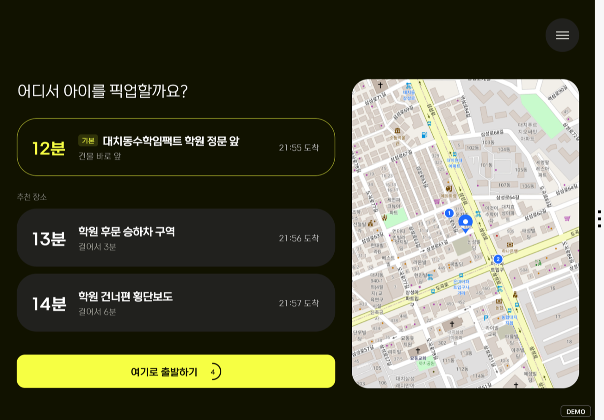
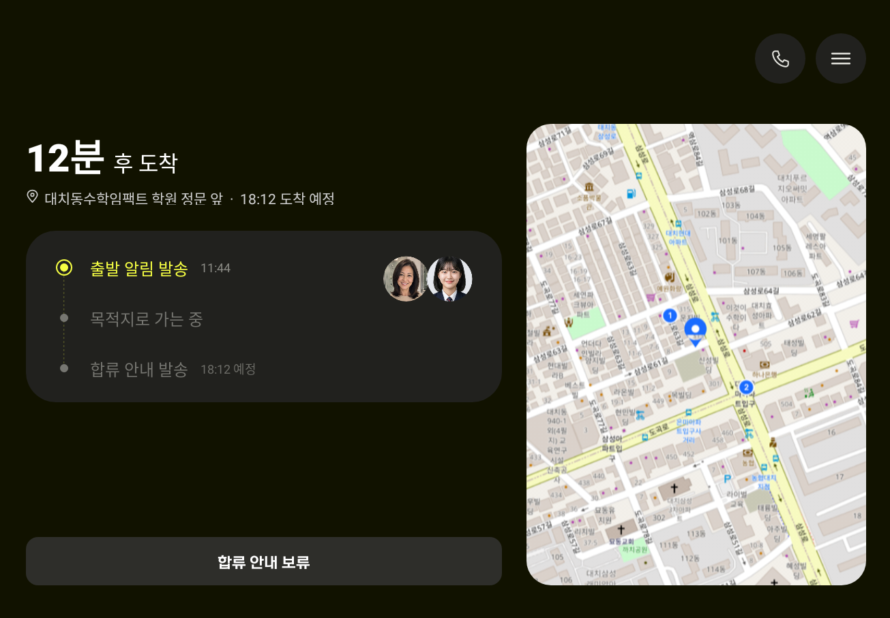
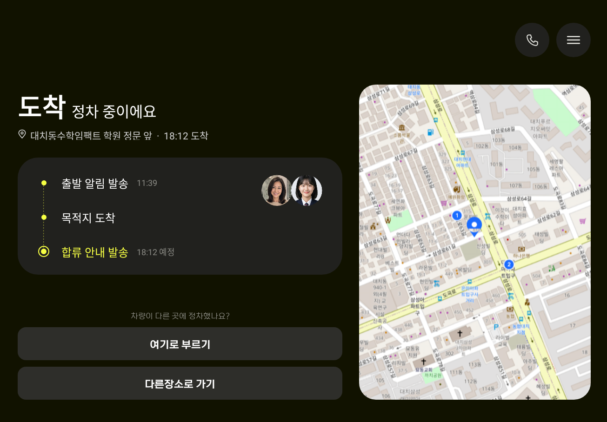
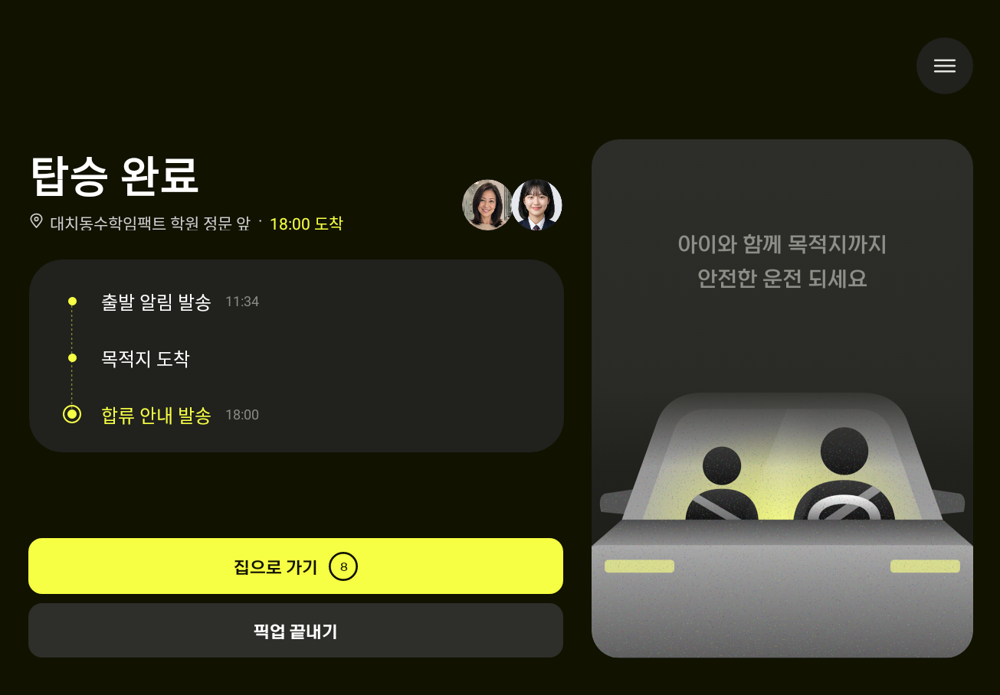
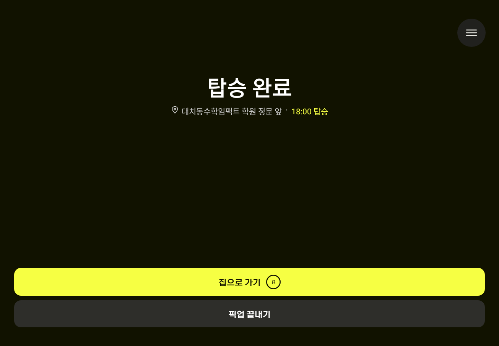

# iLink - 차량 앱

학원 하원 픽업을 도와주는 Pleos Connect 차량용 앱입니다.
보호자 휴대전화 앱([iLink-Client](https://github.com/Hyundai-Motor-Competition/iLink-Client))과 같은 서버를 쓰고, 차에서는 연결 → 오늘의 픽업 → 픽업 장소 선택 → 목적지로 가는 길 → 도착 · 정차 → 탑승 완료 순서로 흘러갑니다.

- 기획안: [iLink 기획안 (구글 시트)](https://docs.google.com/spreadsheets/d/100loJGe8NF_Yxbjat_zQi9Y1dwDjXLRuzn82QDN2BA0/edit) · 0. 기본 플로우 · 2. API 명세서 · 3. 화면 명세서 · 5. QA·MVP 범위

## 화면 예시



| 연결 (V00) | 오늘의 픽업 (V01) |
|---|---|
|  |  |
| **픽업 장소 선택 (V02)** | |
|  | |
| **목적지로 가는 길 (V03)** | **도착 · 정차 중 (V05)** |
|  |  |
| **탑승 완료 · 정차 중** | **탑승 완료 · 주행 중** |
|  |  |

> 앱 창(1305 x 908) 크기 화면입니다. V02는 Pleos Connect 에뮬레이터에서 실제 지도(OpenStreetMap)와 함께 찍었고, 나머지는 `scripts/capture-screens.sh`(에뮬레이터 없이 Robolectric)로 찍었습니다. 캡처에서는 같은 지도 그림을 미리보기로 깔았습니다.

## 화면 흐름

연결(V00) → 오늘의 픽업(V01) → 픽업 장소 선택(V02) → 목적지로 가는 길(V03·V04) → 도착 · 정차(V05 도착) → 탑승 완료(V05) → 오늘의 픽업

| 화면 | 정차 중 | 주행 중 |
|---|---|---|
| V00 서비스 시작·연결 | QR 카드(새 코드 받기 · 남은 시간), 노란 카드(차가 달려와 깃발 앞에 서는 애니메이션), 메뉴 = 나중에 하기 | 로그인 불가 안내 |
| V01 오늘의 픽업 | 인사말, 좌우로 넘기는 날짜 띠(양 끝 흐림), 아이별 픽업 카드 | 다음 픽업 1건 + 시작 |
| V02 픽업 장소 선택 | 장소 카드(운전 시간 · 도착 시각), 추천 장소, 오른쪽 작은 지도, 8초 뒤 자동 출발 | 추천 1곳 + 길안내 |
| V03·V04 목적지로 가는 길 | 남은 시간, 출발 알림 → 가는 중 → 합류 안내 단계, 합류 안내 보류, 오른쪽 지도 | 가운데 좁은 틀 |
| V05 도착 · 정차 중 | 합류 안내 진행, 여기로 부르기(지금 차 위치로 안내), 다른 장소로 가기 | 합류 진행 상태 |
| V06 다른 장소로 가기 | 대안 장소 골라 출발(8초 자동) → 장소 변경 후 다시 길안내 | |
| 탑승 완료 | 진행 단계, 오른쪽 그림, 집으로 가기(8초 뒤 자동, 내비 즐겨찾기 '집'으로 길안내), 픽업 끝내기, 10초 안에는 '아이가 타지 않았어요' | 가운데 제목 · 탑승 시각 + 두 버튼 |
| 안전 확인 필요 | 정차 실패 · 미탑승: 직접 연락, 대안, 보류·취소 | 직접 연락 |
| U01~U08 음성 안내 | 상태가 바뀌면 '발화 중'과 안내 카드를 창에 띄움 (U08은 '상태', '보류' 명령) | |

- 주행/정차는 차량 주행 규제(CarUxRestrictions)로 판단합니다. 데모에서는 기어가 D면 주행 중입니다.
- 화면은 다크 컨셉 하나만 씁니다. Pleos 디자인 가이드는 라이트/다크 둘 다를 요구하지 않고, 글자·아이콘 대비 4.5:1 이상을 요구합니다. 글꼴은 NeoHyundai입니다.
- 오른쪽 작은 지도는 OpenStreetMap(osmdroid, 키 없음)입니다. 길안내는 Pleos 내비가 합니다.
- 합류 안내는 서버 규칙(가드 G6)대로 차가 정차한 뒤에만 나가고, 도착 3분 전(또는 700m)에는 자녀에게 실내 준비 알림이 갑니다.

## 서버 API

- 서버: `https://ilink-api-dev.chisanw.com` (`app/build.gradle.kts`의 `API_BASE_URL`)
- 장소: 저장된 장소(SPOT-01)로 길안내를 확정(SES-04)하고, 추천(SPOT-04 운전 시간 · SPOT-05 학원 근처)은 같은 자리 장소의 시간 표시에 씁니다. SPOT-05 응답은 `{ supported, items }` 객체입니다.
- 서버와 기획서의 차이, 바뀐 규칙은 [docs/api-gap.md](docs/api-gap.md)에 정리했습니다. 전체 API 점검은 모바일 저장소의 `scripts/swagger-smoke.py`로 합니다.

## 개발 환경

- Kotlin, Jetpack Compose, osmdroid(지도), Lottie(V00 애니메이션)
- Pleos Connect 에뮬레이터 v2.1.0 (Android 14, API 34)
- JDK 17 이상, Android SDK 35

## 문서

- 시연 영상 찍는 방법(차량 · 부모 · 자녀 세 화면, 실제 서버): 모바일 저장소의 [docs/demo.md](https://github.com/Hyundai-Motor-Competition/iLink-Client/blob/main/docs/demo.md)
- [docs/design.md](docs/design.md) 구조와 흐름
- [docs/api-gap.md](docs/api-gap.md) 기획서와 서버 API 차이

## 앱 실행 방법

### 준비

- JDK 17 이상, Android SDK 35 (Android Studio)
- Pleos Connect 에뮬레이터 이미지 v2.1.0 (아래 「Pleos 이미지 준비」)

```bash
git clone https://github.com/Hyundai-Motor-Competition/iLink-Vehicle.git
```

```bash
cd iLink-Vehicle
```

### 가장 빠른 실행 (데모 빌드)

서버 · 차량 신호 없이 데모 서버와 가짜 차량으로 전체 흐름을 봅니다.

```bash
scripts/run-pleos.sh
```

에뮬레이터를 띄우고 데모 앱(`com.ilink.vehicle.demo`)을 설치해 실행합니다. 약 12초 뒤 연결이 자동 승인되고 오늘의 픽업(V01)으로 넘어갑니다.

### 실제 서버로 실행

```bash
scripts/run-pleos.sh --real
```

debug 빌드는 시연용 차량 신호 입력(`SimInput`)을 받습니다. Pleos 에뮬레이터는 차량 신호 주입을 막아 두어서, 위치 · 기어 · 주행 여부 · 문 신호를 adb broadcast로 넣습니다.
길안내도 내비 대신 흉내 내고 도착 예정 시간은 위치 · 거리로 계산합니다. release 빌드는 Pleos SDK 값만 씁니다.

```bash
adb shell am broadcast -p com.ilink.vehicle -a com.ilink.vehicle.SIM --es gear D --ez driving true
adb shell am broadcast -p com.ilink.vehicle -a com.ilink.vehicle.SIM --es lat 37.5258 --es lng 126.9255
adb shell am broadcast -p com.ilink.vehicle -a com.ilink.vehicle.SIM --es door REAR_RIGHT --ez open true
```

### 가벼운 Pleos Connect 에뮬레이터로 실행

Pleos Connect 에뮬레이터는 기본 설정(RAM 8GB)으로 띄우면 너무 무거워서, 노트북에서도 돌릴 수 있게 가볍게 띄우는 스크립트를 만들었습니다.

| 스크립트 | 하는 일 |
|---|---|
| `scripts/run-pleos.sh` | Pleos Connect 이미지로 AVD를 만들고 RAM 4GB로 띄운 뒤 앱 설치·실행 (Apple Silicon arm64, Windows · Intel x86_64) |
| `scripts/run-pleos.sh --headless` | 창 없이 띄우기 (캡처만 할 때) |
| `scripts/pleos-flow-capture.sh` | 띄워 둔 에뮬레이터에서 V00 → V03을 자동으로 눌러 가며 캡처 |
| `scripts/run-demo.sh` | Pleos 이미지 대신 일반 Android Automotive 이미지(RAM 2GB)로 더 가볍게 데모 실행 |
| `scripts/capture-screens.sh` | 에뮬레이터 없이 Robolectric으로 화면별 PNG 캡처 (`screenshots/design-light`가 디자인 앱 창 크기) |

```bash
scripts/run-pleos.sh --headless
scripts/pleos-flow-capture.sh
```

#### Pleos 이미지 준비

1. Android Studio > SDK Manager > SDK Update Sites에 Pleos 이미지 주소를 추가합니다.
   - Windows/Linux: `https://nexus-playground.pleos.ai/repository/raw-releases/connect-avd/2.x/crp-sys-img.xml`
   - macOS(Apple Silicon): `https://nexus-playground.pleos.ai/repository/raw-releases/connect-avd/2.x/crp-arm64-sys-img.xml`
2. "Pleos Connect System Image"(API 34)를 설치합니다. AVD는 `run-pleos.sh`가 알아서 만듭니다.

#### 데모 모드

에뮬레이터에는 실제 서버와 차량 신호가 없어서 `demo` 빌드를 따로 두었습니다. (패키지 `com.ilink.vehicle.demo`)

- 서버 응답은 `demo/DemoServer.kt`, 내비·기어·도어·위치 신호는 `demo/DemoWorld.kt`가 대신 냅니다. 앱의 나머지 로직은 실제 빌드와 같습니다.
- 흐름: 연결 코드가 약 12초 뒤 자동 승인 → 픽업 시작 → 이 장소로 길안내(8초 뒤 자동 출발) → 약 1분 동안 접근(도착 3분 전 자녀에게 준비 알림) → 도착 후 기어 P → 정차하면 합류 안내 발송 → 뒷문 개폐로 탑승 감지 → 완료
- 합류 안내는 서버 규칙(가드 G6, 2026.11.13~)대로 정차를 확인한 뒤에만 나갑니다.
- 오른쪽 위 DEMO 버튼으로 주행 규제, 도어 신호 끊김, 바로 도착, 처음부터를 조작할 수 있습니다.

### 빌드 · 테스트

```bash
./gradlew installDebug
```

- API 서버 주소는 `app/build.gradle.kts`의 `API_BASE_URL`에서 바꿉니다.
- 단위 테스트: `./gradlew testDebugUnitTest` (도어 판정, 세션 병합, 음성 안내, 데모 서버 흐름)
